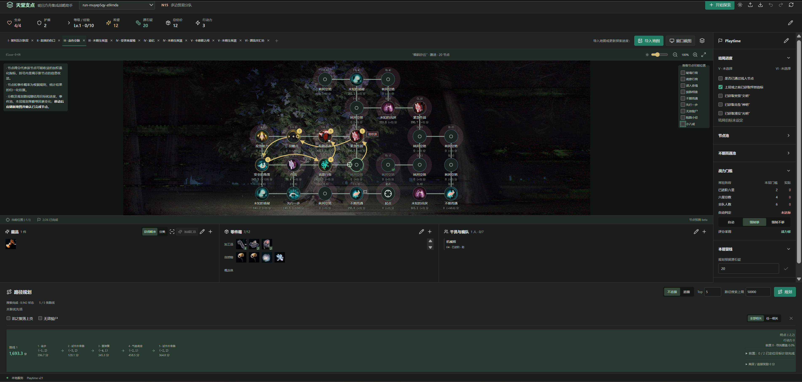

# 天堂支点——明日方舟集成战略助手

**Celestial Fulcrum — Arknights Rogue Assistant**

本项目为面向《明日方舟》集成战略玩家的本地辅助工具：天堂支点（CFARA）。通过游戏截图和玩家补充信息，在本地维护可查看、可修正的对局状态，提供地图认知、节点预测、藏品整合、进度标记、收益估算与路径规划等辅助功能。

通过使用本助手，新手玩家可以获得可解释的节点收益和路径规划建议，安逸探索黑流树海的同时，逐步建立起对“在当前地图、当前资源、当前结局进度下，怎么走能获得最大期望收益”这一肉鸽局外核心决策点的理解。老玩家可以获取随游戏进程刷新的节点和事件预测、节点损益分析、战力统计等实用功能，远离静态memo和错题本、“小助手”一路同行；后续计划更新功能使老玩家能够用自身的游戏理解重写预期收益的积分规则模板，把千人千面的抽象游戏理解抽取为具象的数学模型，建立属于自己的“肉鸽专家系统.skill”。

## 开始使用

当前提供 Windows x64 和 macOS（Apple Silicon）桌面应用，请从 [GitHub Releases 发布页](https://github.com/YLFF/celestial-fulcrum/releases)选择本平台的最新版本。

1. 按对应平台的方式解压并启动，在独立程序窗口中使用。
2. 点击“开始探索”，输入游戏难度、分队、支援条件等初始状态初始化一局游戏实例（Playtime），通过上传游戏截图自动识别、手动维护资源和游戏策略，查看节点收益或路径规划。Windows 也支持应用内窗口截图；macOS 当前使用上传或拖入截图。
3. 亦可以通过导入 Playtime 文件、或在任何游戏内任一层进行初始化，无缝接入天堂支点系统。

当前 Windows 构建要求 Windows 10/11 x64、.NET Framework 4.8 和 [Microsoft WebView2 Runtime](https://developer.microsoft.com/en-us/microsoft-edge/webview2/)。移动端筹备中。

### 测试包被系统阻止启动时

Windows 测试包未签名，macOS 测试包使用临时签名，尚未经过 Apple 公证。请在确认风险的情况下，下载来自本项目未被篡改的可信文件后，才考虑允许启动；不要关闭全局安全防护。

- **Windows：**先在下载的 ZIP 上右键，选择“属性 → 解除锁定 → 应用”，再完整解压。若已经解压且启动失败，解锁原 ZIP 后重新解压到一个新目录。若出现 SmartScreen 的发布者提示，核实来源后可通过“更多信息 → 仍要运行”允许这份应用；若系统明确报告恶意软件，请停止运行。窗口运行库缺失时，安装上面的 WebView2 Runtime。
- **macOS：**尝试打开 `.app` 后，如果系统提示开发者无法验证或应用未公证，可在“系统设置 → 隐私与安全性”中检查对应提示，确认信任后选择“仍要打开”。若系统报告应用损坏或含恶意软件，不要直接绕过提示，应重新下载并检查文件。操作参考 [Apple 官方说明](https://support.apple.com/zh-cn/102445)。
- **仍无法启动：**保留错误提示和应用数据目录中的 `logs/desktop.log`，反馈时注明应用版本及系统版本。数据目录见下方“存档与隐私”。

## 界面总览与使用说明

**每次移动/完成节点后建议刷新地图并确认已完成节点。** 节点预测、收益期望和路线规划结果会根据实时地图、藏品、零件和干员等资源情况更新，支持连续完成多个节点后更新，但应注意参考最新的节点收益预估和路线规划。实际获得的资源、使用的加工品及已经历事件以最新截图和玩家确认值为准，所有元素可人工校准。

**探索有风险，操作需谨慎。**未知节点类别和事件概率由节点生成规则和统计样本估算得出，~~天堂支点的道德准则不允许骇入金字塔获取绝密情报~~。节点预期得分和路径规划由天堂支点内置评分算法得出，且仍在迭代优化中，仅供参考，一脚踩进黑诞导致被猎犬捕食的风险本助手概不负责。

## 功能使用说明

1. Playtime 管理：助手以 Playtime 为单位管理数据，对应每一次肉鸽探索。可在助手右上角点击“开始探索”，输入初始条件从零新建一局游戏状态，也可以从上次结束的地方继续，或随时导出、导入 Playtime 文件，每个 Playtime 包含完整的历史信息和当前游戏状态。也可随时在局内编辑 Playtime 的全局策略，改变结局和前置节点的战略选择。通过撤回、重做功能，可以每一步移动为单位回溯和重做探索进程，便于复盘和模拟不同决策的收益情况。
2. 地图实例导入与更新：可使用导入本地截图、或从游戏进程截取图片的形式获取并识别层数、地图模板、节点、当前位置、标记与实托邦等地图信息，并通过二维地图模型的形式展示和供探索者查看编辑。在同一层地图中前进后，可以重新识别新截图和探索进程，保留已通过的节点信息。完成不期而遇节点后，可通过点击节点录入事件信息如“愈创之心”，后续节点池将根据事件重复规则进行更新。即使进入新一层、树洞，也可以切换页签查看已录入的地图信息，~~妈妈再也不用担心我忘记洞外节点了~~。
3. 节点预测：结合节点生成规则、距离统计、数量估计和已探明节点情况计算未知节点的分类概率，同时维护本层及全局不期而遇事件池提供决策参考。可通过“查看节点可能位置”勾选框，查看某类节点在的可能所处位置；也可点击未知节点，查看该节点可能的概率分布。并进而查看不期而遇各事件的概率、不同节点可能获得的藏品和零件情况。
4. 资源维护：可通过识图自动读取或手动校正基础行动力、希望、源石锭等等基础资源；另可识别或编辑藏品、零件箱、干员及编队、结局进度等游戏进程中的客观资源信息。
5. 藏品管理：支持独立识别截图底栏可见的最新藏品，也可手动搜索添加；典训、发泡胶等附魔类藏品可选择对应干员生效。支持查看藏品加成合并总览，提供数值评估参考依据。已获取的藏品在后续事件可能获取的藏品池中会自动排除，便于预测筛藏。
6. 零件箱管理：零件箱仅支持手动管理，加工品用于路径规划、自然物和概念体根据各自效果参与节点收益计算。为避免计数混乱，除板藤、苔藓外的自然物估价不会自动更新，对于估价统一变化的事件可手动录入，包括获得干员、获得零件（已自动化、一般不需使用）、战斗胜利、揭示节点、希望的沃土步数和~~我树碎了？！~~，方便玩家进行更新零件箱估价。
7. 数值参考：以藏品为核心提供当前数值情况的分类加总展示，如局内生命加成、局外攻击加成等指标。点击“加成汇总”，可查看当前生效藏品，以及对应加成效果一览，区分生存伤害控制等多个类别加总显示，如会自动合并尖叫樱桃、仇名录与希望沃土提供的局外加攻。在干员一览界面也可查看适用于该干员的加成总览，如老近卫军之锋、发泡胶在藏品总览不会计入，但在生效的干员加成页面则会计入，方便对当前战力进行评估。
8. 干员与编队：管理本局招募的干员信息，同时可以将典训、发泡胶等附魔类藏品选择对应干员生效。干员信息可以作为战力估算的一环参与路径规划。
9. 节点期望分：节点期望分根据该节点可能事件与对应的**资源收益**、到达该节点揭示未知节点的**信息收益**、当前藏品与干员综合计算的综合计算的**战力水平**、是否期望走等结局前置节点/是否追猎/是否给美人鱼等事件预留现金等**本层战略**综合计算得出，具体计算逻辑和权重可参考 `data/scoring/` 下的 JSON 文件，后续也计划开放用户本地自行编辑和导入评分模板和逻辑的功能。
10. 路径规划（待完善功能）：支持全局规划和一步建议两种模式，会根据当前节点得分情况、剩余行动力、备选加工品、追猎选择及结局前置偏好等条件搜索尽量满足条件的高分路线，并展示逐步收益、揭示收益与评分依据。请注意，每次移动和完成节点、以及当前各项资源的变化都会影响节点期望得分和路径规划结果，建议在每次移动后刷新地图、确认已完成节点情况和资源变化后重新规划。

### 节点评分和路径规划如何理解

- **适合完全参考本规划功能的目标用户：对肉鸽或本次树海主题的玩法不够熟悉、导致不管用什么分队，常态通关率或通关时的藏品数量<50的萌新玩家（请勿见怪）**。请酌情阅读使用。
- 节点分是可能收益的加权量化指标，括号内是揭示新节点的信息收益。
- 节点分和路径规划的计算方式会受到“战力是否充足”这一门槛条件的影响，战力不足时经验/希望/招募券资源的得分权重会增加，更倾向于普通作战/绿商店消费来补充战斗力。战力判断根据层数和干员/藏品情况根据公式计算得出，对自身局内实力有明确认知的玩家可点击主界面右侧的强制够/不够来控制该权重，使得评分和规划方式更加激进/保守。
- 节点分类概率是规则与统计数据下的归一化估算，其中包含开发者根据统计数据和主观经验的建模假设；并非游戏官方生成概率。
- 路径搜索受「路径搜索上限」约束，输出当前状态下找到的较优方案，不保证全局最优，也不预知后续随机结果。
- 规划中的现金、估价、商店与奖励变化属于预测状态，不会自动改写真实存档。
- 截图识别可能受鼠标遮挡、缩放、特效及相似图标影响。请审核结果；地图、节点标记和资源均可手动修正。
-  **Attention**：该功能目前还处于人工智障阶段，对于黑流树海的二维地图，每走一步都会因揭示节点、战斗力的变化极大改变地图情况并导致全局路径规划几乎失去意义；不断变化的零件箱内容、结局前置与是否追猎的的权衡等因素也会让探索决策复杂性几何式增加。当前的全局路径规划功能仅能够提供在已知地图和加工品情况下理论收益较高的探索路线，在4/5层参考价值较低；一步路径建议会考虑当前能够抵达的节点及其后续可能获得的末端收益，根据加工品和节点分布情况可能导致在一个集中的低收益区域不断徘徊，落入局部最优。
- 改进一步规划建议可能是后续重点考虑的研发方向，目标是建立**有全局意识的下一步决策器**：掌握本层大致目标、当前资源与地图信息，比较多种合法的一步走法，并给出建议、取舍和调整条件。

## 存档与隐私

地图识别、OCR、节点预测与路径搜索在本机运行，核心功能不需要上传截图到外部服务。窗口截图由用户选择目标并授权。

存档、图片和日志等用户数据保存在以下用户目录，不写入程序包：

- Windows：`%LOCALAPPDATA%\CFARA`，通常为 `C:\Users\<用户名>\AppData\Local\CFARA`。
- macOS：`~/Library/Application Support/CFARA`，即 `/Users/<用户名>/Library/Application Support/CFARA`。

目录内的 `runs` 保存对局，`images` 保存上传图片，`logs/desktop.log` 为桌面日志。

## 开发说明

开发说明见 [docs/DEVELOPMENT.md](docs/DEVELOPMENT.md)，可配合 `data/scoring/` 下的打分配置 JSON 食用，后续也计划开放本地调整和导入自定义评分模板的功能。

后续计划开发路径见 [ROADMAP.md](docs/ROADMAP.md)。当前重点是实战校准收益期望、藏品战斗加成结构化汇总，以及基于规则和 Playtime 的 LLM 交互~~小助手评论：这种配置也能倒在无效验尸，用户你的局内还得练.mp3~~。

欢迎开发者和玩家参与项目，提交bug、建议和PR。由于开发者本人打集实力有限~~双盘全追三不削只有商店队通关记录~~，当前的节点收益量化评分和路径规划算法可能存在考虑要素不全、权重不合理、分队不适配、过于极端或保守的情况，也欢迎玩家带应用截图或完整对局 Playtime 文件（应用数据目录下的 `runs/<对局ID>/`）提交issue，讨论对应节点收益和路径规划。

## 数据、素材与鸣谢

地图模板、节点生成规则及节点与事件统计参考自 [路标档案馆](https://www.lubiao.wiki/)，干员资料与游戏条目参考 [PRTS Wiki](https://prts.wiki/)； 藏品计算与合并规则参考自[影语集](https://arkrog.com/)；。感谢明日方舟社区各位贡献者、玩家长期的热情付出与数据整理。

~~感谢sol小妹不辞辛劳的数据整理、思路讨论和底层编码工作。~~

本项目是非官方辅助工具，与《明日方舟》官方无隶属关系。游戏名称、图像等素材及第三方数据的权利归各自权利人；构建可运行程序不等于已取得公开再分发授权。第三方程序依赖的许可证随测试包保留。

## 许可证

项目自有程序代码与构建脚本采用 **GNU GPL-3.0-only**，完整条款见 [LICENSE](LICENSE)，适用范围及第三方材料说明见 [NOTICE](NOTICE)。应用免费发布；GPL 仍允许商业使用和收费分发，发布原版或修改版时须遵守对应源码提供等义务。当前仓库为私有仓库，分发程序时也必须让接收者能够取得对应版本的源码，不能仅提供无访问权限的链接。

游戏素材、路标与 PRTS 数据及第三方依赖不因项目采用 GPL 而变更其原有权利或授权条件。Windows 包在程序目录附带 LICENSE 和 NOTICE；macOS 包在应用内的 `Contents/Resources/` 附带这两份文件。
